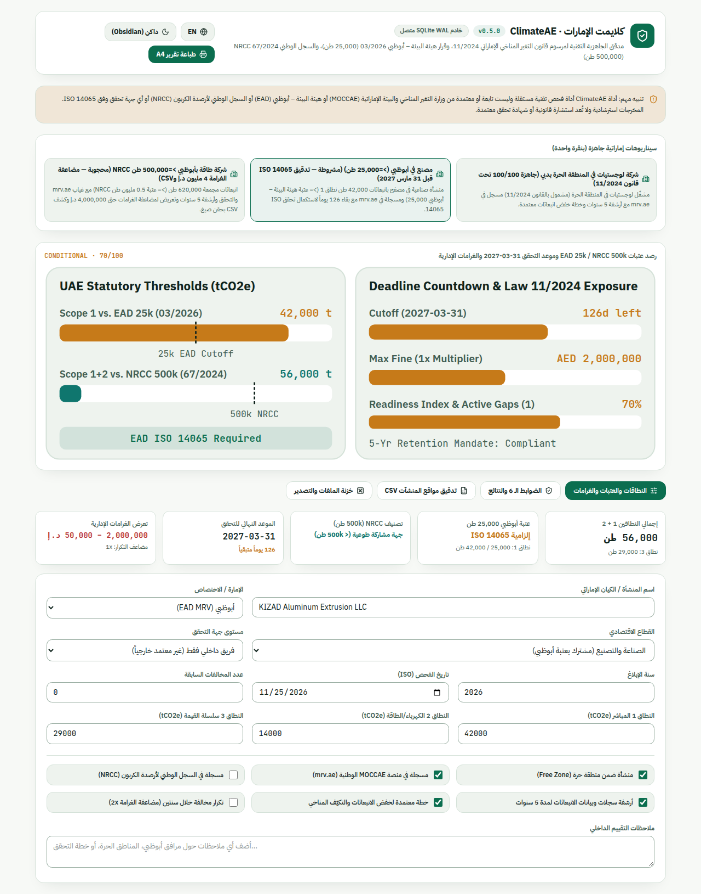
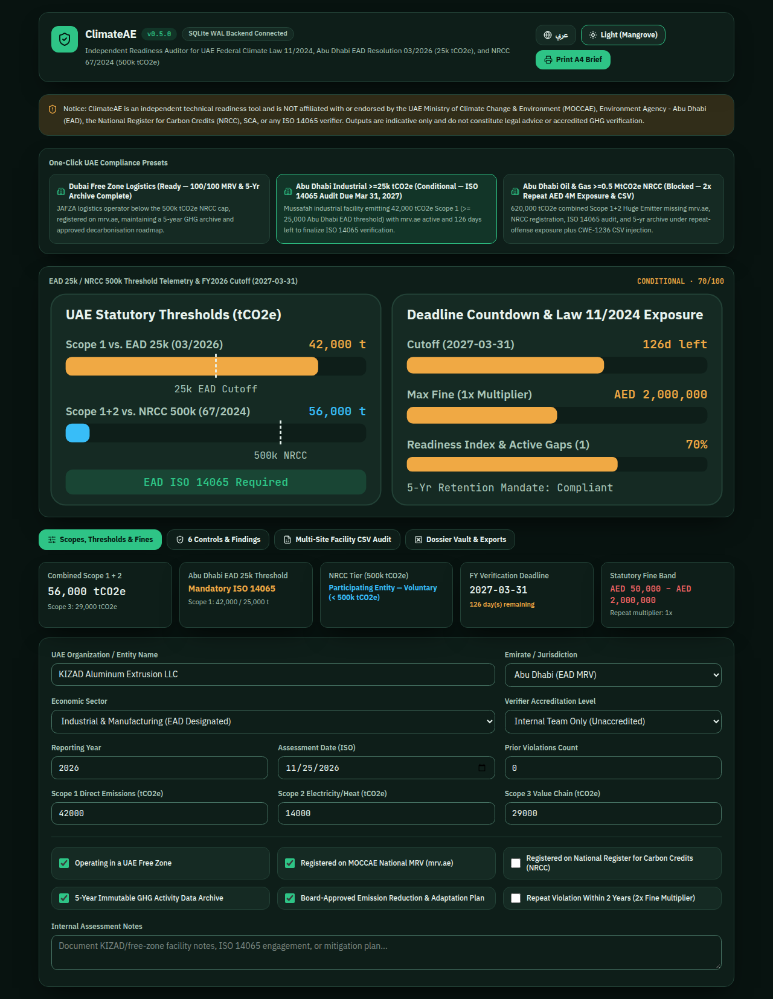
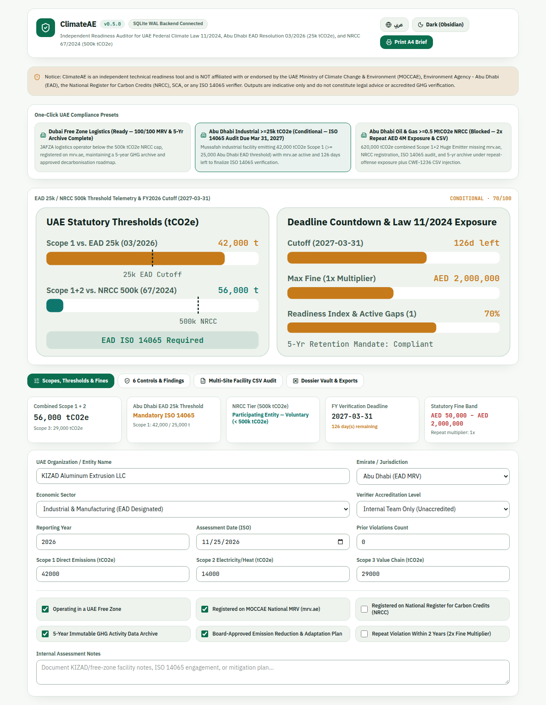
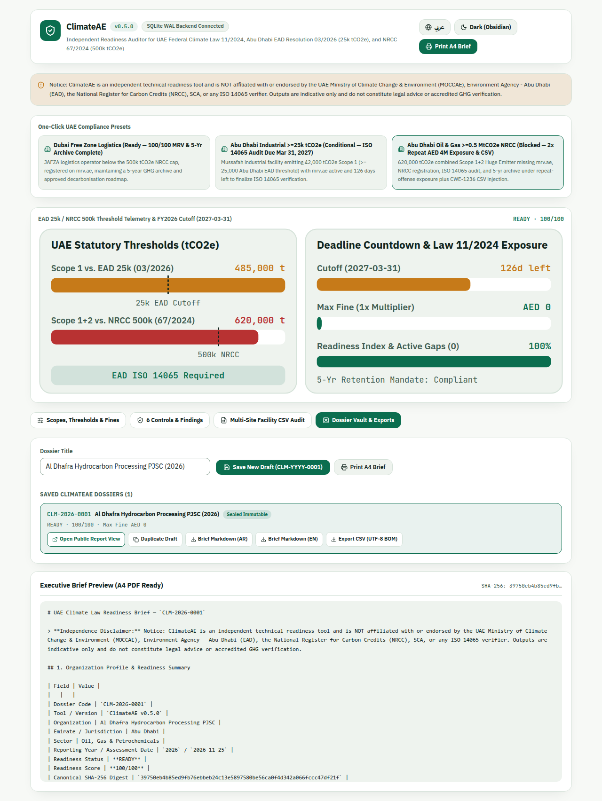
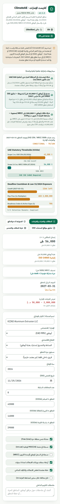
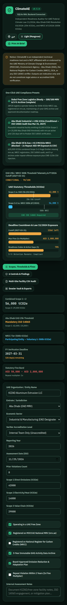

# ClimateAE — UAE Climate Law (`11/2024`), Abu Dhabi EAD MRV (`03/2026`) & NRCC (`67/2024`) Studio

[](LICENSE)

> **Bilingual (`AR RTL` `Mangrove Vellum` Light & `EN LTR` `Desert Obsidian` Dark) · Dual-Mode (`Node 22 + SQLite WAL` or `$0` Browser Static Mode)**

Zero-runtime-backend-dependency technical readiness calculator, `node:sqlite WAL` API server, and bilingual **Arabic (`RTL`) / English (`LTR`)** web application covering the United Arab Emirates climate regulatory framework:

- **Federal Decree-Law No. (11) of 2024** *(effective 2025-05-30)*:
  - Covers both **UAE mainland and all financial/commercial free zones** (`mrv.ae` national registration).
  - Enforces **5-year GHG emissions & activity data record retention** and reduction/adaptation roadmaps.
  - Models statutory administrative penalty exposure (`AED 50,000 – AED 2,000,000` per violation, **doubled `2x` up to `AED 4,000,000`** for repeat offenses within 2 years).
- **Abu Dhabi EAD Resolution No. (03) of 2026 (`Abu Dhabi MRV`)**:
  - Classifies designated Abu Dhabi sectors (industrial/manufacturing, power & water, oil & gas, transport & logistics, waste) at **`>= 25,000 tCO2e/year` Scope 1** as mandatory MRV entities requiring independent **`ISO 14065` / `ISO 14064-3`** verification.
  - Tracks the annual **`YYYY-03-31`** verification cutoff (e.g., `2027-03-31` for FY2026).
- **Cabinet Resolution No. (67) of 2024 (`NRCC`)**:
  - Distinguishes mandatory **Huge Carbon Emitters (`>= 500,000 tCO2e/year` Scope 1 + Scope 2)** vs. voluntary **Participating Entities** on the National Register for Carbon Credits.
  - Audits multi-site UAE facility GHG CSV ledgers with **`CWE-1236` formula injection neutralization**, **`UTF-8 BOM` (`EF BB BF`)** export, and canonical `SHA-256` digests.

> **Independence & Legal Disclaimer**: ClimateAE is an independent technical utility and is **NOT affiliated with, endorsed by, or connected to** the UAE Ministry of Climate Change & Environment (`MOCCAE`), Environment Agency - Abu Dhabi (`EAD`), the National Register for Carbon Credits (`NRCC`), SCA, or any `ISO 14065` accredited verifier. All outputs are indicative and do not constitute legal or GHG verification advice.

---

## Visual Showcase (`AR RTL` & `EN LTR`)

### Desktop Arabic RTL (`Mangrove Vellum` Light — Abu Dhabi >=25k tCO2e `70/100`)


### Desktop English LTR (`Desert Obsidian` Dark)


### Abu Dhabi EAD `25,000 tCO2e` Conditional Cutoff (`2027-03-31`, `126d` Left)


### Remediated NRCC `>=500k` Portfolio & Sealed `CLM-2026-0001` Dossier (`SHA-256`)


### Mobile Arabic RTL View (`Mangrove Vellum`, `390x844`)


### Mobile English LTR View (`Desert Obsidian`, `390x844`)


---

## Quick Start (Local)

```bash
npm install
npm run typecheck
npm test
npm run build
npm start
# Opens HTTP + node:sqlite WAL backend on http://127.0.0.1:4229/climateae
```

Run headless Chrome Playwright end-to-end tests:

```bash
npm run test:e2e
```

## `$0` Static Deploy (Cloudflare Workers Assets)

```bash
npm run build
npx wrangler deploy
```

When served without the Node backend, the UI automatically runs in **Browser `$0` Mode**, keeping all threshold engines (`src/core/*`), SHA-256 sealing, Markdown briefs, and BOM CSV exports working via `localStorage`.

## Self-Hosted Docker / SQLite WAL Deploy

```bash
docker compose up -d --build
# Runs Node 22 built-in HTTP + SQLite WAL persistence on 127.0.0.1:4229
```

## Key API Endpoints (Node 22 Built-In Server)

| Method & Route | Description |
|---|---|
| `GET /health`, `GET /readyz` | Liveness & SQLite WAL readiness probes (exempt from rate limits) |
| `GET /api/presets` | Three realistic UAE 2026 climate scenarios (Free Zone, EAD 25k, NRCC 500k) |
| `POST /api/scope-thresholds` | Federal Law `11/2024`, EAD `25k tCO2e`, and NRCC `500k tCO2e` classifier |
| `POST /api/penalty-deadline` | `YYYY-03-31` cutoff countdown & `AED 50k–4M` penalty estimator |
| `POST /api/audit-csv` | Multi-site facility CSV auditor (`CWE-1236` safe + `UTF-8 BOM`) |
| `POST /api/assess` | Full readiness assessment with 6 weighted controls & canonical `SHA-256` digest |
| `GET/POST /api/dossiers` | Persistent `node:sqlite WAL` dossier vault (`CLM-YYYY-0001` atomic codes) |
| `POST /api/dossiers/:code/finalize` | Cryptographically seal dossier & generate shareable public slug |
| `GET /api/dossiers/:code/brief.md` | Download bilingual (`?lang=ar` or `en`) Markdown compliance brief |
| `GET /api/dossiers/:code/export.csv` | Download `UTF-8 BOM` CSV audit report (`CWE-1236` sanitized) |
| `GET /api/public/reports/:slugOrCode` | Public read-only sealed report JSON with persistent view counter |

## License

MIT
